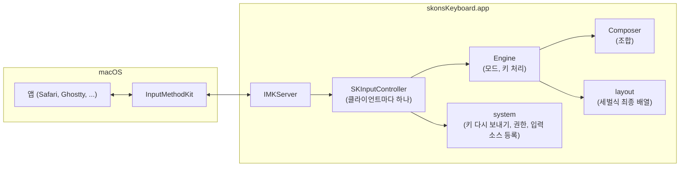
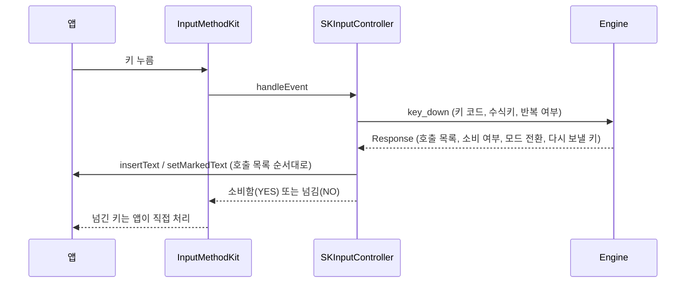
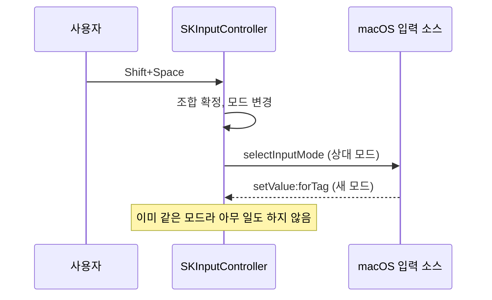
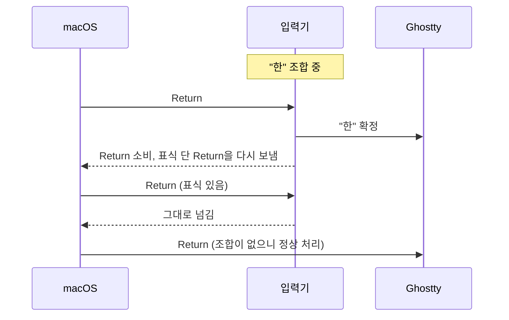
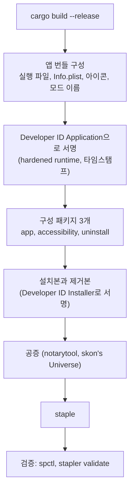

# 구조와 동작 방식

이 문서는 skon's Keyboard가 어떻게 동작하는지 설명합니다. 동작의 기준은 `spec/STANDARD.md`이며, 이 문서의 § 번호는 그 문서의 절을 가리킵니다. 이 문서와 스펙이 다르면 스펙이 맞습니다.

## 1. 전체 구성

- 입력기는 InputMethodKit 입력기 번들 하나(`skonsKeyboard.app`)이고, 모두 Rust로 작성했습니다(§2.2). Apple 프레임워크는 objc2 crate로 부릅니다.
- macOS는 앱이 키를 받을 때마다 InputMethodKit을 거쳐 입력기의 컨트롤러(`SKInputController`)를 부릅니다. 컨트롤러는 앱(클라이언트)마다 하나씩 생깁니다.
- 키를 어떻게 처리할지는 macOS와 무관한 순수 Rust 코드(`Engine`, `Composer`, `layout`)가 정합니다. 그래서 앱 없이 테스트할 수 있습니다(§7.5).

## 2. 소스 구성

| 파일 | 역할 |
|---|---|
| `src/layout.rs` | 세벌식 최종 배열표 47개 키(§4.1). 가상 키 코드로 키를 찾습니다. |
| `src/composer.rs` | 한 음절의 조합 규칙과 조합 결합표(§4.2), 화면에 보일 글자(§4.3). |
| `src/engine.rs` | 두 모드의 키 처리 결정(§3, §4.4, §4.5, §5). 앱에 할 호출 목록을 돌려줍니다. |
| `src/spec_tests.rs` | 스펙 문서의 배열표와 결합표를 읽어 코드의 표와 비교하는 테스트. |
| `src/mac/controller.rs` | InputMethodKit 컨트롤러. macOS 이벤트를 `Engine`에 넘기고 결과를 앱에 적용합니다. |
| `src/mac/client.rs` | 앱(클라이언트)에 보내는 호출. 글자 넣기, 조합 중 글자 표시, 모드 선택, 자판 지정. |
| `src/mac/system.rs` | 키 다시 보내기와 손쉬운 사용 권한(§4.5), 입력 소스 등록과 해제(§8). |
| `src/mac/mod.rs` | 입력기 서버 실행, 식별자 상수, 현재 모드. |
| `src/main.rs` | 실행 파일. 인자가 없으면 입력기로 동작하고, 설치 스크립트용 보조 명령이 있습니다. |
| `resources/` | `Info.plist`, 모드 이름(`en.lproj/InfoPlist.strings`), 메뉴 막대 아이콘. |
| `packaging/` | 설치본과 제거본의 화면 정의, 설치 스크립트, 안내 페이지. |
| `xtask/` | 설치본을 만드는 명령 `cargo xtask package`(§8.5). |

## 3. 키 하나가 처리되는 과정

1. 컨트롤러는 키 누름 이벤트만 받습니다(§7.2 규칙 6). 그래야 마우스 클릭 때 InputMethodKit이 알아서 조합을 확정합니다.
2. `Engine::key_down`이 §4.4의 표를 위에서부터 차례로 적용해 `Response`를 만듭니다.
   - 앱에 할 호출: 글자 확정(`Insert`), 조합 표시(`SetMarked`), 조합 지우기(`ClearMarked`)
   - 키를 소비할지 앱에 넘길지
3. 컨트롤러는 `Response`의 호출을 순서대로 앱에 적용한 뒤 소비 여부를 돌려줍니다. 그래서 키를 넘기기 전에 넣을 글자는 이미 다 들어가 있습니다(§7.2 규칙 3).

## 4. 조합 엔진

- 음절은 초성 < 중성 < 종성 세 칸입니다. 자모 키가 오면 §4.2의 규칙 세 가지 중 하나를 적용합니다.
  - 규칙 1: 다음 칸이 비어 있으면 그 칸을 채웁니다.
  - 규칙 2: 마지막 칸과 결합할 수 있으면 결합합니다.
  - 규칙 3: 둘 다 아니면 지금 음절을 확정하고 새 음절을 시작합니다.
- `Composer`는 키를 칠 때마다 직전 상태를 `history`에 쌓습니다. Backspace는 이 기록을 하나 되돌리므로, 자모 단위로 지워집니다.
- 화면에 보이는 글자는 §4.3을 따릅니다. 초성과 중성이 있으면 완성형 음절이고, 아니면 칸마다 호환 자모를 씁니다. 예를 들어 `ㅏ`와 `ㄱ`만 있으면 "ㅏㄱ"입니다.
- 배열표와 결합표는 스펙과 똑같아야 합니다. `src/spec_tests.rs`가 `spec/STANDARD.md`의 표를 직접 읽어 비교하므로, 둘 중 하나만 고치면 테스트가 실패합니다.

## 5. 모드 전환

- 두 모드는 각각 별도의 입력 소스입니다(§3). Shift+Space는 시스템에서 선택된 입력 소스 자체를 바꿉니다(`selectInputMode`).
  - 그래서 메뉴 막대 아이콘이 바뀝니다.
  - Ghostty는 키 처리 전후로 입력 소스가 바뀌었는지 보고 그 키를 버립니다. 덕분에 Shift+Space가 공백으로 새지 않습니다.
- 시스템이 모드를 바꿨다고 알려 오면(`setValue:forTag:client:`) 그대로 따르기만 하고, 다시 모드 변경을 요청하지 않습니다. 요청하면 Chromium 계열 앱에서 무한 반복이 생길 수 있기 때문입니다.
- 현재 모드는 모든 컨트롤러가 함께 씁니다(`CURRENT_MODE`). 새 앱으로 옮겨 가면 그 앱의 컨트롤러가 활성화될 때 현재 모드를 따릅니다.
- 활성화될 때와 모드가 바뀔 때마다 ABC 자판을 지정합니다(`overrideKeyboardWithKeyboardNamed`). 그래서 넘긴 키와 단축키는 언제나 QWERTY 자리로 동작합니다(§5).

## 6. 앱과 주고받는 방식

여러 앱에서 문제없이 동작하도록 §7.2의 규칙을 지킵니다. 대부분 다른 입력기와 앱에서 실제로 문제가 됐던 경우를 피하려는 것입니다.

| 규칙 | 구현 | 피하는 문제 |
|---|---|---|
| 조합은 첫 자모부터 밑줄 친 조합 중 글자로 보임 | 밑줄과 조합 구간 속성을 붙인 문자열, 커서는 끝 | 첫 글자가 자모로 풀려 들어가는 문제, Chrome에서 조합 글자가 선택된 것처럼 보이는 문제 |
| 범위를 지정해 바꾸지 않음 | 모든 호출의 교체 범위가 `NSNotFound` | Chrome과 Firefox의 순서 꼬임, Zed에서 여러 커서에 잘못 적용되는 문제 |
| 확정은 한 번만 | 조합이 비어 있으면 아무 호출도 하지 않음 | 확정이 늦게나 여러 번 올 때 글자가 두 번 들어가는 문제 |
| 다른 호출 도중의 요청은 미룸 | 키 처리 중에는 `in_key_event`가 켜지고, 그동안 온 확정과 모드 변경은 처리가 끝난 뒤 실행 | 앱이 `insertText` 도중에 비활성화를 다시 부르는 경우 |
| 제어문자는 글자로 넣지 않음 | 배열표에 제어문자가 없음 | 터미널과 Zed에 제어문자가 그대로 들어가는 문제 |

`Engine`은 앱 호출이 없는 순수 코드라서, 컨트롤러는 `Engine`을 빌려 쓰는 동안 앱을 부르지 않습니다. §4.5에 필요한 앱 정보(번들 ID)도 `Engine`을 부르기 전에 미리 구합니다. 그래서 앱이 호출 도중에 컨트롤러를 다시 불러도 `Engine`을 이중으로 빌리지 않습니다.

## 7. 터미널의 Return과 Esc (§4.5)

Terminal과 Ghostty는 한글 조합을 끝내면서 앱에 넘긴 키를 버리는 경우가 있습니다(§7.4 L1). 예를 들어 Ghostty 1.3.1은 입력기가 글자를 확정한 키 입력에서 Return과 Esc를 인코딩하지 않고, 확정된 글자만 보냅니다. macOS 기본 한글 입력기도 같은 증상이 있습니다.

- 조건(모두 만족할 때만): 앱이 Terminal(`com.apple.Terminal`)이나 Ghostty(`com.mitchellh.ghostty`)이고, 손쉬운 사용 권한이 있고, 수식키 없는 Return이나 Esc이고, 조합 중입니다.
- 다시 보내는 이벤트에는 `eventSourceUserData`에 표식(`SKRP`)을 답니다. 입력기는 표식이 있는 이벤트를 다른 처리 없이 넘깁니다.
- 권한은 사용 중에 묻지 않고 있는지만 확인합니다(`CGPreflightPostEventAccess`). 권한 설정은 설치할 때 정합니다(§8.2).
- 같은 방식을 쓰는 다른 한글 입력기가 있습니다. 구름 입력기의 한 포크(zidell/gureum)와 ongeul입니다. iTerm2는 이 문제를 터미널 쪽에서 고쳤습니다.

## 8. 설치본

`cargo xtask package`가 다음을 차례로 합니다(§8.5).

- 결과물: `target/package/skonsKeyboard-<버전>.pkg`(설치본), `target/package/skonsKeyboard-Uninstall-<버전>.pkg`(제거본)
- 앱 번들이 다른 위치로 옮겨 설치되지 않도록 구성 정보에서 재배치를 끕니다(`BundleIsRelocatable = NO`).
- 설치본은 두 가지 선택 항목을 보여 줍니다.
  - 입력기: 필수
  - 터미널 Return/Esc 보정: 선택, 기본값은 선택 안 함
- 설치 스크립트는 관리자 권한으로 돕니다. 사용자 세션이 필요한 일은 `launchctl asuser`로 콘솔 사용자 세션에서 입력기 실행 파일의 보조 명령을 부릅니다.

| 보조 명령 | 부르는 곳 | 하는 일 |
|---|---|---|
| `skonsKeyboard --register` | 설치 | 입력 소스를 등록하고 두 모드를 켬 |
| `open -a skonsKeyboard.app --args --request-accessibility` | 터미널 보정을 고른 설치 | 손쉬운 사용 권한 요청 창을 띄움 |
| `skonsKeyboard --unregister` | 제거 | 두 모드를 끔 |

- 권한 요청은 반드시 입력기 앱이 해야 권한이 입력기에 붙습니다. 그래서 `open`(Launch Services)으로 입력기를 실행합니다. 터미널에서 실행 파일을 바로 실행하면 권한이 터미널 앱에 붙을 수 있습니다.
- 제거본은 입력 소스를 끄고, 실행 중인 입력기를 종료하고, 번들을 지우고, 권한 기록(`tccutil reset`)과 설치 기록(`pkgutil --forget`)을 지웁니다.

## 9. 서명과 공증

- 앱은 Developer ID Application 인증서로, 설치본과 제거본은 Developer ID Installer 인증서로 서명합니다. 공증은 키체인 프로필 `skon's Universe`로 받습니다(§8.4).
- Developer ID로 서명하면 업데이트해도 서명 신원이 같아서, 손쉬운 사용 권한이 유지됩니다.
- 지금 쓰는 두 Developer ID 인증서는 2027-02-01에 만료됩니다. 만료된 Installer 인증서로 서명한 설치본은 다시 서명해야 설치할 수 있으므로, 그 전에 Xcode에서 인증서를 새로 만듭니다.

## 10. 테스트

- `cargo test`: 앱 없이 도는 테스트입니다.
  - 배열표, 조합 규칙, 스펙 예시(§4.2)
  - 키 처리 표의 각 행(§4.4), Shift+Space, 터미널 조건(§4.5)
  - 스펙 문서와 코드의 표 비교, `Info.plist`와 코드의 식별자 비교
- 앱별 동작은 설치한 뒤 §7.3의 인수 시나리오를 보장 대상 앱마다 손으로 확인합니다.

## 11. 참고 자료

- InputMethodKit Rust 바인딩: https://docs.rs/objc2-input-method-kit
- Ghostty의 입력기 처리: https://github.com/ghostty-org/ghostty/blob/main/macos/Sources/Ghostty/Surface%20View/SurfaceView_AppKit.swift
- Ghostty 1.3.1 키 인코딩: https://github.com/ghostty-org/ghostty/blob/v1.3.1/src/input/key_encode.zig
- 구름 입력기: https://github.com/gureum/gureum
- 구름 입력기 포크의 Return 재전송: https://github.com/zidell/gureum/commit/6e03ee3
- ongeul: https://github.com/hiking90/ongeul
- iTerm2의 수정: https://github.com/gnachman/iTerm2/commit/52fdf26
- 공증: https://developer.apple.com/documentation/security/notarizing-macos-software-before-distribution
