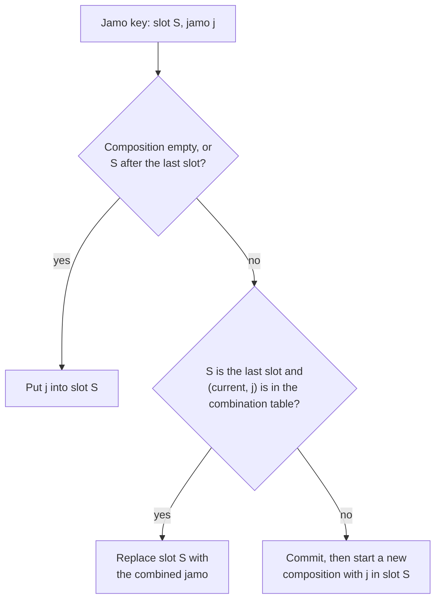
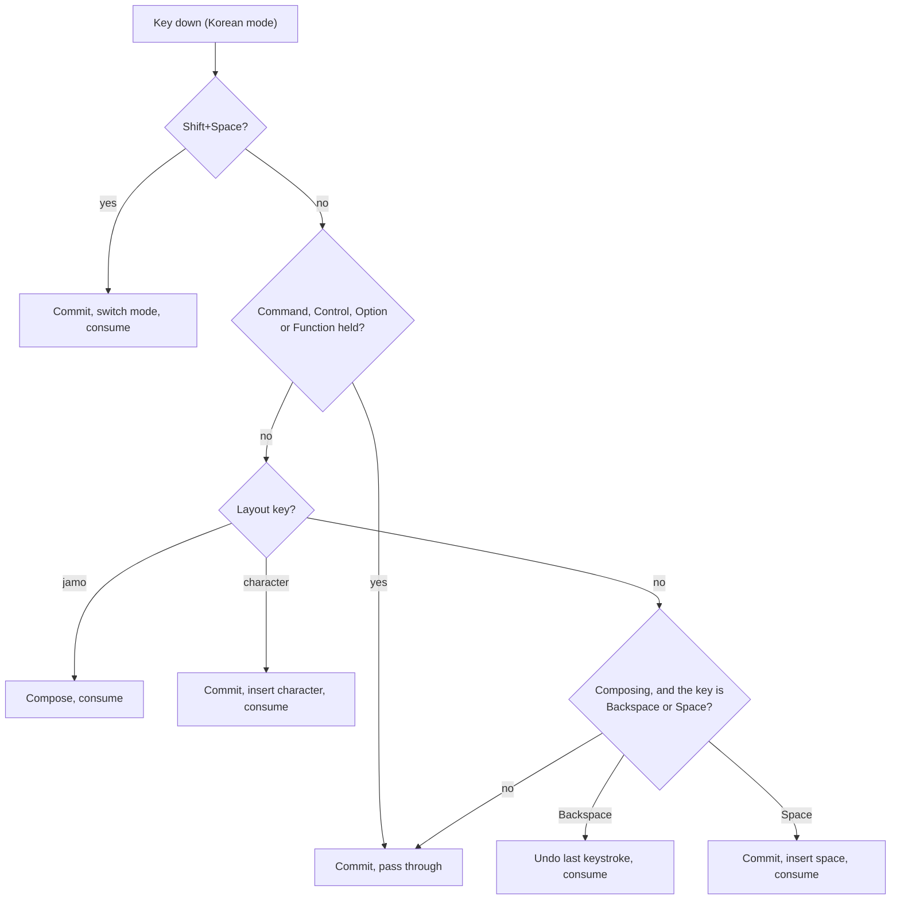
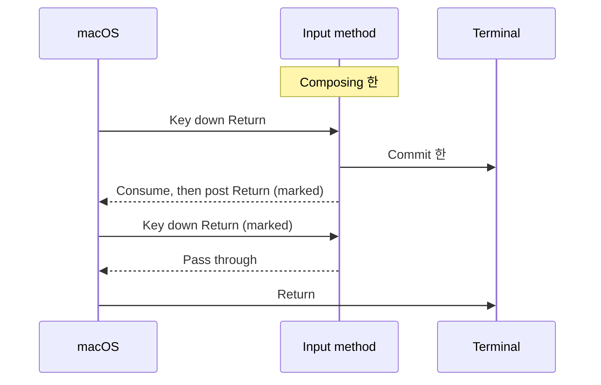
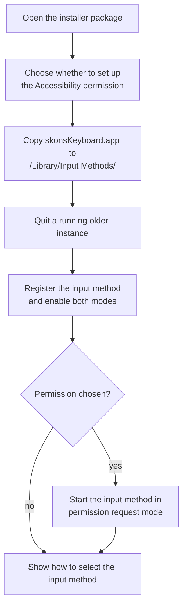
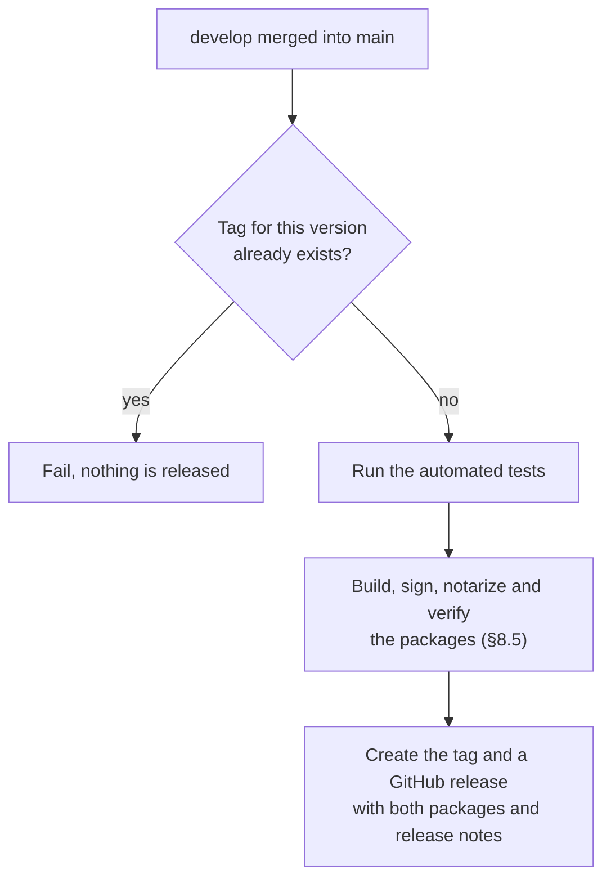
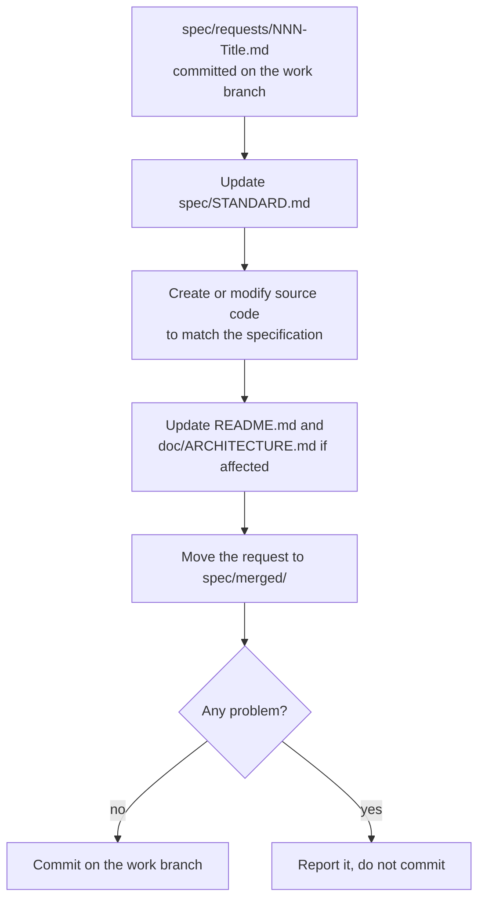

# skon's Keyboard — Standard

This is the specification of skon's Keyboard. It is the only normative
document of the project: when any other document or the source code conflicts
with it, this document is correct and the other must be fixed (§9.1).

## Contents

- [1. Overview](#1-overview)
  - [1.1 Purpose](#11-purpose)
  - [1.2 Scope](#12-scope)
  - [1.3 Conventions](#13-conventions)
- [2. Platform and Technology](#2-platform-and-technology)
  - [2.1 Platform](#21-platform)
  - [2.2 Implementation](#22-implementation)
  - [2.3 Identity and installation](#23-identity-and-installation)
  - [2.4 Resource and privacy constraints](#24-resource-and-privacy-constraints)
- [3. Modes and Switching](#3-modes-and-switching)
- [4. Korean Mode](#4-korean-mode)
  - [4.1 Layout](#41-layout)
  - [4.2 Composition](#42-composition)
  - [4.3 Text representation](#43-text-representation)
  - [4.4 Key handling](#44-key-handling)
  - [4.5 Return and Escape in terminals](#45-return-and-escape-in-terminals)
- [5. English Mode](#5-english-mode)
- [6. Voice Input](#6-voice-input)
- [7. Application Compatibility](#7-application-compatibility)
  - [7.1 Guaranteed applications](#71-guaranteed-applications)
  - [7.2 Client interaction rules](#72-client-interaction-rules)
  - [7.3 Acceptance scenarios](#73-acceptance-scenarios)
  - [7.4 Known limitations](#74-known-limitations)
  - [7.5 Verification](#75-verification)
- [8. Distribution and Installation](#8-distribution-and-installation)
  - [8.1 Installer](#81-installer)
  - [8.2 Accessibility permission](#82-accessibility-permission)
  - [8.3 Uninstaller](#83-uninstaller)
  - [8.4 Signing and notarization](#84-signing-and-notarization)
  - [8.5 Building the packages](#85-building-the-packages)
  - [8.6 Verification](#86-verification)
  - [8.7 Release](#87-release)
- [9. Project Documents and Process](#9-project-documents-and-process)
  - [9.1 Documents](#91-documents)
  - [9.2 Spec requests](#92-spec-requests)
  - [9.3 Work branches](#93-work-branches)
  - [9.4 Applying a request](#94-applying-a-request)
  - [9.5 Discussion items](#95-discussion-items)

## 1. Overview

### 1.1 Purpose

skon's Keyboard is a Korean/English input method for macOS. It is built for
one user's needs, not as a general-purpose input method: it provides only the
features in this document and is designed to stay lightweight.

### 1.2 Scope

| Feature | Section |
|---|---|
| Switching between Korean and English with Shift+Space | §3 |
| Korean input with the Sebeolsik Final layout | §4 |
| English input with the QWERTY layout | §5 |
| Voice input for Korean and English speech | §6 (not yet specified) |
| Guaranteed operation in a fixed list of applications | §7 |
| Signed installer packages and automatic releases | §8 |

Out of scope: other Hangul layouts (2-set, 3-90, ...), Old Hangul, Hanja
conversion, auto-correction or prediction, a settings UI or configuration
files, and platforms other than macOS.

### 1.3 Conventions

The key words MUST, MUST NOT, SHOULD, SHOULD NOT and MAY are used as described
in RFC 2119.

| Term | Meaning |
|---|---|
| Client | The text view of an application that receives input. |
| Mode | Korean mode or English mode of the input method. |
| Composition | The syllable being typed in Korean mode. The client shows it as marked text (underlined, not yet final). |
| Commit | Send the composition to the client as final text, then clear it. Committing an empty composition does nothing. |
| Pass through | Return a key event unhandled, so the client processes it as if no input method were active. |
| Consume | Handle a key event so that the client does not receive it. |
| Jamo | A Hangul letter. In Korean mode each jamo is an initial consonant (choseong), a medial vowel (jungseong) or a final consonant (jongseong). |

## 2. Platform and Technology

### 2.1 Platform

The input method runs on macOS 26 or later, on Apple Silicon (arm64). Other
macOS versions and Intel Macs are not supported.

### 2.2 Implementation

- The product is an input method bundle built on InputMethodKit. Typing
  (§3–§5) MUST work without a helper process, a login item, the Input
  Monitoring permission or the Accessibility permission.
- The Accessibility permission is optional. When granted, it enables only the
  handling of Return and Escape in terminals (§4.5).
- The implementation language is Rust. Apple frameworks are called through
  the objc2 crates.
- Swift MAY be used only for an Apple API that cannot be called from Rust.
  Every such use MUST be listed here. Current Swift uses: none.

### 2.3 Identity and installation

| Item | Value |
|---|---|
| Display name | skon's Keyboard |
| Bundle | `skonsKeyboard.app` |
| Bundle identifier | `com.skon.inputmethod.skonsKeyboard` |
| Connection name | `com.skon.inputmethod.skonsKeyboard_Connection` |
| Korean mode | ID `com.skon.inputmethod.skonsKeyboard.Korean`, name "Sebeolsik Final", menu bar icon "한" |
| English mode | ID `com.skon.inputmethod.skonsKeyboard.English`, name "QWERTY", menu bar icon "A" |
| Install location | `/Library/Input Methods/` (all users) |

The display name always starts with a lowercase "skon".

macOS launches an input method only if its bundle identifier contains
`.inputmethod.`, and expects the connection name to be the bundle identifier
followed by `_Connection`.

Distribution and installation are specified in §8.

### 2.4 Resource and privacy constraints

- While no input happens, the input method MUST NOT run timers, polling or
  background threads.
- Typing in Korean or English mode MUST NOT perform file or network I/O.
- The input method MUST NOT store, log or transmit typed text.

## 3. Modes and Switching

The input method has exactly two modes: Korean mode (§4) and English mode
(§5). Each mode is a separate input source of the input method: Korean mode
has the Korean script, and English mode has the Roman script (ASCII-capable).
The menu bar therefore always shows the current mode, and applications can
tell whether keys are being composed.

- **Shift+Space** is a Space key press while Shift is the only one of Shift,
  Control, Option, Command and Function (fn/Globe) that is held. Caps Lock is
  ignored.
- On Shift+Space the input method commits the composition, switches to the
  other mode and consumes the event. The client never receives Shift+Space.
- Switching MUST change the input source selected in the system, not only an
  internal state. Some terminals decide whether a key was consumed by
  checking whether the input source changed.
- In Ghostty (`com.mitchellh.ghostty`), the input method also inserts an empty
  string when Shift+Space is pressed with no composition. Ghostty decides
  whether a key was consumed from what happened while it handled the key,
  and the mode change reaches it only afterwards, so it would otherwise send
  Shift+Space to the shell as a space. Ghostty treats a key during which text
  was inserted as consumed, and sends nothing for an empty string.
- Auto-repeated Shift+Space events (from holding the keys down) MUST be
  consumed without switching again.
- When the system changes the mode (for example, the user selects it in the
  input menu), the input method commits the composition and follows the
  change. It MUST NOT request a mode change in response, because doing so can
  start a feedback loop in some applications.

## 4. Korean Mode

### 4.1 Layout

Korean mode uses the Sebeolsik Final layout, also known as 3-91 or the
Gong Byeong-u Final layout. Keys are identified by their physical position on
an ANSI keyboard and named by their US QWERTY legend without Shift.

In the tables below, "initial ㄱ", "medial ㅏ" and "final ㄱ" are the Unicode
conjoining jamo of that role (initial U+1100–U+1112, medial U+1161–U+1175,
final U+11A8–U+11C2). A value in code format is a character that is inserted
as is.

**Number row**

| Key | Without Shift | With Shift |
|---|---|---|
| `` ` `` | `*` | `※` |
| `1` | final ㅎ | final ㄲ |
| `2` | final ㅆ | final ㄺ |
| `3` | final ㅂ | final ㅈ |
| `4` | medial ㅛ | final ㄿ |
| `5` | medial ㅠ | final ㄾ |
| `6` | medial ㅑ | `=` |
| `7` | medial ㅖ | `“` |
| `8` | medial ㅢ | `”` |
| `9` | medial ㅜ | `'` |
| `0` | initial ㅋ | `~` |
| `-` | `)` | `;` |
| `=` | `>` | `+` |

**Top row**

| Key | Without Shift | With Shift |
|---|---|---|
| `q` | final ㅅ | final ㅍ |
| `w` | final ㄹ | final ㅌ |
| `e` | medial ㅕ | final ㄵ |
| `r` | medial ㅐ | final ㅀ |
| `t` | medial ㅓ | final ㄽ |
| `y` | initial ㄹ | `5` |
| `u` | initial ㄷ | `6` |
| `i` | initial ㅁ | `7` |
| `o` | initial ㅊ | `8` |
| `p` | initial ㅍ | `9` |
| `[` | `(` | `%` |
| `]` | `<` | `/` |
| `\` | `:` | `\` |

**Home row**

| Key | Without Shift | With Shift |
|---|---|---|
| `a` | final ㅇ | final ㄷ |
| `s` | final ㄴ | final ㄶ |
| `d` | medial ㅣ | final ㄼ |
| `f` | medial ㅏ | final ㄻ |
| `g` | medial ㅡ | medial ㅒ |
| `h` | initial ㄴ | `0` |
| `j` | initial ㅇ | `1` |
| `k` | initial ㄱ | `2` |
| `l` | initial ㅈ | `3` |
| `;` | initial ㅂ | `4` |
| `'` | initial ㅌ | `·` |

**Bottom row**

| Key | Without Shift | With Shift |
|---|---|---|
| `z` | final ㅁ | final ㅊ |
| `x` | final ㄱ | final ㅄ |
| `c` | medial ㅔ | final ㅋ |
| `v` | medial ㅗ | final ㄳ |
| `b` | medial ㅜ | `?` |
| `n` | initial ㅅ | `-` |
| `m` | initial ㅎ | `"` |
| `,` | `,` | `,` |
| `.` | `.` | `.` |
| `/` | medial ㅗ | `!` |

Korean mode cannot produce `` ` `` `@` `#` `$` `^` `&` `_` `[` `]` `{` `}`
`|`. To type them, switch to English mode.

### 4.2 Composition

The composition is a syllable with three slots in a fixed order:
initial < medial < final. Each slot is empty or holds one jamo. The *last
slot* is the filled slot that comes latest in that order.

When a jamo key (slot S, jamo j) is pressed:

1. If the composition is empty, or S comes after the last slot, put j into
   slot S.
2. Otherwise, if S is the last slot and the combination table below has an
   entry for (current jamo of S, j), replace slot S with the combined jamo.
3. Otherwise, commit the composition, then start a new composition with j in
   slot S.

Combination table:

| Slot | Combinations |
|---|---|
| Initial | ㄱ+ㄱ=ㄲ, ㄷ+ㄷ=ㄸ, ㅂ+ㅂ=ㅃ, ㅅ+ㅅ=ㅆ, ㅈ+ㅈ=ㅉ |
| Medial | ㅗ+ㅏ=ㅘ, ㅗ+ㅐ=ㅙ, ㅗ+ㅣ=ㅚ, ㅜ+ㅓ=ㅝ, ㅜ+ㅔ=ㅞ, ㅜ+ㅣ=ㅟ, ㅡ+ㅣ=ㅢ |
| Final | ㄱ+ㄱ=ㄲ, ㄱ+ㅅ=ㄳ, ㄴ+ㅈ=ㄵ, ㄴ+ㅎ=ㄶ, ㄹ+ㄱ=ㄺ, ㄹ+ㅁ=ㄻ, ㄹ+ㅂ=ㄼ, ㄹ+ㅅ=ㄽ, ㄹ+ㅌ=ㄾ, ㄹ+ㅍ=ㄿ, ㄹ+ㅎ=ㅀ, ㅂ+ㅅ=ㅄ, ㅅ+ㅅ=ㅆ |

A medial vowel typed after a final consonant always starts a new syllable
(rule 3). Unlike 2-set layouts, the final consonant never moves to the next
syllable.

**Backspace** while composing undoes the most recent keystroke of the
composition: the composition returns to the state it had before that
keystroke. When it becomes empty, the composition ends. Committed text is
never decomposed.

Examples (keys are QWERTY legends; `⌫` is Backspace):

| Keys | Composition after each key | Result |
|---|---|---|
| `m f s k g w` | ㅎ → 하 → 한 → ㄱ (한 committed) → 그 → 글 | 한글 |
| `n c ; t w n d x` | ㅅ → 세 → ㅂ → 버 → 벌 → ㅅ → 시 → 식 | 세벌식 |
| `k k f` | ㄱ → ㄲ → 까 | 까 |
| `k v f` | ㄱ → 고 → 과 | 과 |
| `k f w x` | ㄱ → 가 → 갈 → 갉 | 갉 |
| `k f x f` | ㄱ → 가 → 각 → ㅏ (각 committed) | 각ㅏ |
| `k f x ⌫ ⌫` | ㄱ → 가 → 각 → 가 → ㄱ | ㄱ |

### 4.3 Text representation

The composition is shown as marked text and committed as the same string:

- If the initial and medial slots are filled, it is the precomposed syllable
  U+AC00 + (L × 21 + V) × 28 + T, where L = initial − U+1100,
  V = medial − U+1161, and T = final − U+11A7 (T = 0 when the final slot is
  empty).
- Otherwise, it is the Hangul Compatibility Jamo (U+3131–U+3163) of each
  filled slot, in slot order. For example, an initial ㄱ alone is U+3131, and
  a medial ㅏ followed by a final ㄱ is U+314F U+3131.

### 4.4 Key handling

The first row that matches a key down event applies.

| Key event | While composing | While not composing |
|---|---|---|
| Shift+Space | Commit, switch to English mode, consume | Switch to English mode, consume (in Ghostty, also insert an empty string; §3) |
| Any key with Command, Control, Option or Function held | Commit, pass through | Pass through |
| Backspace | Undo the last keystroke (§4.2), consume | Pass through |
| Layout key that produces a jamo | Compose (§4.2), consume | Start a composition, consume |
| Layout key that produces a character | Commit, insert the character, consume | Insert the character, consume |
| Space | Commit, insert a space, consume | Pass through |
| Any other key (Return, Tab, Escape, arrows, keypad, ...) | Commit, pass through | Pass through |

- A *layout key* is one of the 47 keys in §4.1, pressed with or without Shift
  and with no other modifier. Caps Lock is ignored: only Shift selects the
  column of the table.
- The input method MUST also commit the composition when the system asks it
  to (for example, the user clicks elsewhere, focus moves to another text
  view, or another input source is selected).

Space during a composition is inserted by the input method together with
the commit, as the macOS built-in Korean input method does. In Terminal and
Ghostty, Return and Escape follow §4.5 when its conditions hold.

### 4.5 Return and Escape in terminals

Terminal and Ghostty may drop a passed-through key that ends a composition
(§7.4 L1). When all of the following hold, Return and Escape are handled as
described here instead of as in §4.4:

- the client is Terminal (`com.apple.Terminal`) or Ghostty
  (`com.mitchellh.ghostty`),
- the input method has the Accessibility permission,
- the key is Return or Escape, with none of Shift, Control, Option, Command
  and Function held, and
- a composition exists.

The input method then commits the composition, consumes the key event, and
posts the same key again (key down and key up). It marks the events it posts,
and passes a marked event through without any other handling when it arrives.
Without the Accessibility permission, §4.4 applies.

The input method only checks whether it has the permission and never asks
for it. The permission is set up during installation (§8.2).

## 5. English Mode

- Every key event is passed through, except Shift+Space (§3).
- In both modes, passed-through key events are interpreted with the ABC
  keyboard layout (`com.apple.keylayout.ABC`). English mode therefore types
  QWERTY, and keyboard shortcuts in Korean mode use QWERTY positions.

## 6. Voice Input

Requested: speak and have the recognized text inserted, for both Korean and
English speech, without choosing the language by hand.

Status: not yet specified. Discussion: `doc/DEVELOPMENT/voice-input.md`.
Until this section specifies it, the input method has no voice input.

## 7. Application Compatibility

### 7.1 Guaranteed applications

| Category | Applications |
|---|---|
| Web browsers | Safari, Firefox, Google Chrome |
| Editors | Zed, Xcode |
| Terminals | Terminal, Ghostty |
| Messengers | Slack, Messages |
| Email | Mail |

Each guaranteed application MUST pass every scenario in §7.3, in its latest
stable version at the time of verification. Other applications are supported
on a best-effort basis.

### 7.2 Client interaction rules

These rules apply to every client. They follow what works across the
guaranteed applications.

1. The composition is shown as marked text from its first jamo, with a
   single underline and the cursor at its end. Uncommitted jamo are never
   inserted as final text.
2. Text is always inserted, and marked text always set, at the client's
   current selection. The input method never asks the client to replace a
   particular range.
3. While handling a key event, the input method inserts all text before it
   returns whether the event is passed through.
4. Committing is idempotent: each composition is committed at most once, even
   when the system asks for a commit late, repeatedly, or in the middle of
   another call. When nothing changes, the input method makes no call to the
   client. The only exception is the empty string inserted in Ghostty (§3).
5. Control characters (U+0000–U+001F, U+007F) are never inserted as text.
6. The input method handles key down events only. Mouse events and modifier
   key changes are never consumed.
7. The input method posts key events only as specified in §4.5.

### 7.3 Acceptance scenarios

Keys are QWERTY legends. Each scenario starts in an empty text field. In
terminals, A2 and A10 pass in one key press only when the input method has the
Accessibility permission (§4.5). Otherwise, and for A5 and A11, the
limitations in §7.4 apply.

| # | Steps | Expected result |
|---|---|---|
| A1 | Korean mode: type `m f s k g w`, then Space. | `한글 ` is inserted. While typing, the composition is shown inline as marked text. |
| A2 | Korean mode: type `m f s`, then Return. | `한` is committed exactly once, then Return takes effect exactly once (new line, or send in a messenger). No character is duplicated, lost, or left behind in the field. |
| A3 | Korean mode: type `k f s`, then Backspace three times. | The composition goes 간 → 가 → ㄱ → empty, and nothing is inserted. |
| A4 | Korean mode: type `m f s`, then click elsewhere in the field. Repeat, switching to another application and back instead of clicking. | `한` is committed exactly once each time. |
| A5 | Korean mode: type `m f s`, then Left Arrow. | `한` is committed, then the cursor moves one character left. |
| A6 | Korean mode: type `m f s`, Shift+Space, then `abc`. | `한abc` |
| A7 | English mode: type `abc`, Shift+Space, then `m f s`. | `abc한` |
| A8 | Korean mode: type `m f s`, then Command+A, Command+C, Command+V. | `한` is committed, then the shortcuts act on QWERTY positions (select all, copy, paste). |
| A9 | Korean mode: type Shift+`j`, Shift+`k`, Shift+`l`, `[`, `]`. | `123(<` |
| A10 | Korean mode: type `m f s`, then Escape. | `한` is committed, then the application receives Escape. |
| A11 | Terminals only. Korean mode: type `m f s`, then Control+C. | `한` is committed, then the shell receives Control+C. |
| A12 | English mode: hold down `a`. | Key repeat works as with the ABC layout. |
| A13 | Terminals only. With nothing composed, press Shift+Space twice. | Nothing is sent to the shell, and the mode is back where it started. |

### 7.4 Known limitations

| # | Applications | Limitation |
|---|---|---|
| L1 | Terminal, Ghostty | When a passed-through key ends a composition, the terminal may keep the committed text but drop the key, so the key must be pressed again. This is reported for Return and Escape in both terminals, and for Tab and arrow keys in Ghostty, where version 1.3.1 may instead lose the committed text. The macOS built-in Korean input method has the same problem. With the Accessibility permission, §4.5 avoids it for Return and Escape. |
| L2 | All | In password fields, macOS allows only ASCII-capable input sources, so Korean mode is not available there. |
| L3 | Terminal, Ghostty | With §4.5, a key typed before the posted Return or Escape arrives may be processed ahead of it. |
| L4 | Ghostty | A program that enables the kitty keyboard protocol still receives Shift+Space as a key event (for example `CSI 32;2u`), because Ghostty encodes the key itself when no text comes with it. What happens then depends on the program. |

### 7.5 Verification

- The composition rules (§4.2–§4.4) MUST be covered by automated tests that
  run without a client. The tests MUST pass before every commit.
- The scenarios in §7.3 are verified by hand in every guaranteed application
  whenever a change affects key handling or text output.

## 8. Distribution and Installation

### 8.1 Installer

- The input method is distributed as a signed installer package (`.pkg`).
  Installing it does not need the source code or a Rust toolchain.
- The package installs `skonsKeyboard.app` into `/Library/Input Methods/` for
  all users. macOS asks for an administrator password.
- After copying the bundle, the installer:
  1. quits a running older instance of the input method,
  2. registers the input method and enables both modes for the user who
     installs it,
  3. sets up the Accessibility permission if the user chose it (§8.2).
- The installer's last page explains how to select the input method, and
  that logging out and in may be needed after the first installation.

### 8.2 Accessibility permission

- The installer shows an optional item, not selected by default, to set up
  the Accessibility permission used by §4.5.
- If the item is selected, the installer starts the input method once in a
  permission request mode, in the installing user's session. macOS then asks
  the user to allow the input method, not the installer, to use
  Accessibility.
- Because the app is signed with Developer ID (§8.4), a granted permission
  stays granted when the input method is updated.

### 8.3 Uninstaller

- A separate uninstaller package SHOULD be provided. It has lower priority
  than the installer.
- The uninstaller disables the input sources, quits the input method, deletes
  `/Library/Input Methods/skonsKeyboard.app`, and resets the input method's
  Accessibility permission record.

### 8.4 Signing and notarization

- The app is signed with a Developer ID Application certificate, with the
  hardened runtime and a secure timestamp.
- The packages are signed with a Developer ID Installer certificate, notarized
  by Apple, and stapled, so that macOS opens them without a warning after they
  are downloaded.
- Notarization uses the notarytool keychain profile `skon's Universe`.
- A package signed with an expired Developer ID Installer certificate must be
  re-signed before it can be installed. Installed apps keep running after the
  certificate expires.

### 8.5 Building the packages

- One command, run from the repository, builds the app and the packages,
  signs them, and notarizes them. The command is written in Rust as part of
  the Cargo workspace (§2.2) and is described in README.md.

### 8.6 Verification

- For each package, `spctl --assess --type install -vv` reports `accepted`
  with the source `Notarized Developer ID`, and `xcrun stapler validate`
  succeeds.
- After installation on a Mac where the input method was not installed, both
  modes can be selected (after logging out and in if needed), and the
  scenarios in §7.3 pass.

### 8.7 Release

A release is made automatically when develop is merged into main (§9.3).

- The release runs on GitHub Actions when commits are pushed to main, on a
  GitHub-hosted Apple Silicon macOS runner whose Xcode has the macOS 26 SDK
  or later.
- The release:
  1. reads the version from `Cargo.toml` and fails if the tag `v<version>`
     already exists;
  2. runs the automated tests (§7.5);
  3. builds, signs, notarizes and verifies the packages with the command of
     §8.5;
  4. creates the tag `v<version>` and a GitHub release named
     "skon's Keyboard <version>", with both packages attached.
- The release notes list the spec requests added to `spec/merged/` since the
  previous release tag, one line each with the file name and the first line
  of the request. The first release lists all of them.
- If any step fails, no tag and no release are created.

The signing certificates and the notary key are stored as repository secrets:

| Repository secret | Content |
|---|---|
| `DEVELOPER_ID_P12` | The Developer ID Application and Developer ID Installer certificates with their private keys, exported together as one `.p12` file and base64-encoded |
| `DEVELOPER_ID_P12_PASSWORD` | The password of that `.p12` file |
| `NOTARY_KEY` | The contents of the App Store Connect API key file (`.p8`) |
| `NOTARY_KEY_ID` | The key ID of that API key |
| `NOTARY_ISSUER_ID` | The issuer ID of that API key |

The runner imports the certificates into a temporary keychain and stores the
API key there as the notarytool profile of §8.4, so that the command of §8.5
works unchanged. The keychain is deleted when the release ends.

## 9. Project Documents and Process

### 9.1 Documents

| Path | Role | Language |
|---|---|---|
| `spec/STANDARD.md` | The specification (this document). The only normative document. | English only |
| `spec/STANDARD/` | Supplementary files of the specification, such as figures. | English only |
| `spec/requests/` | Spec requests waiting to be applied. | Any |
| `spec/merged/` | Spec requests already applied. | Any |
| `README.md` | Installation and usage, kept short. | Korean |
| `doc/ARCHITECTURE.md` | Detailed description of how the app works, with figures and videos. | Korean |
| `doc/ARCHITECTURE/` | Supplementary files of `doc/ARCHITECTURE.md`. | Korean |
| `doc/DEVELOPMENT/` | Open discussion items, one file per item. | Korean |

Documents under `doc/` are written in Korean unless there is a specific
reason to use another language.

If any document or source code conflicts with this specification, the
specification is correct and the other MUST be fixed.

### 9.2 Spec requests

- A spec request is a file `spec/requests/NNN-Title.md`, where `NNN` is a
  three-digit sequence number starting at `000` (for example,
  `000-Project.md`).
- This specification changes only by applying spec requests.

### 9.3 Work branches

- A request is applied on the branch where the request file is committed.
  That branch is the work branch.
- The work branch MUST NOT be `main` or `develop`. If a request is committed
  on one of them, that is a problem that needs the user's decision (§9.4).
- Merging develop into main makes a release (§8.7). The version in
  `Cargo.toml` MUST be raised before develop is merged into main.

### 9.4 Applying a request

1. Update this specification to reflect the request.
2. Create or modify the source code so that it matches the specification.
3. Update README.md and `doc/ARCHITECTURE.md` when they are affected.
4. Move the request file from `spec/requests/` to `spec/merged/`.
5. If no problem occurred, commit on the work branch automatically. A problem
   is a failed build or test, or a question that needs the user's decision.

### 9.5 Discussion items

- A question that needs discussion during development is recorded as one
  file in `doc/DEVELOPMENT/`.
- When the question is resolved, the file is deleted. If the answer changes
  this specification, the change is applied through a spec request.
